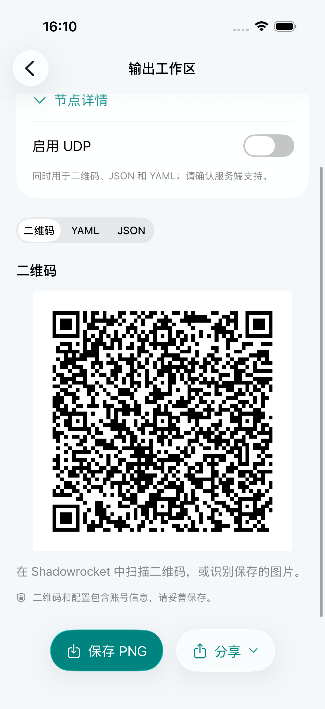
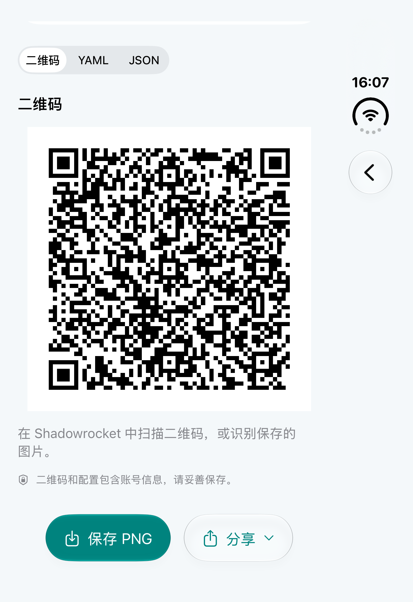
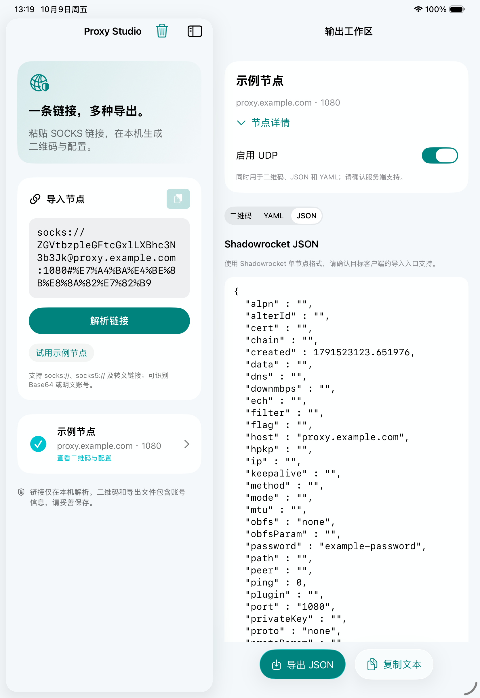
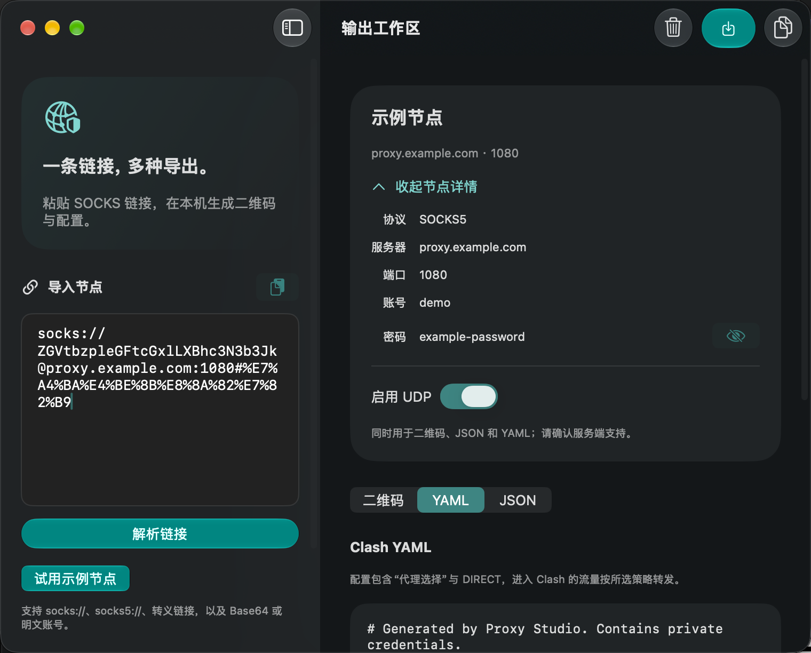
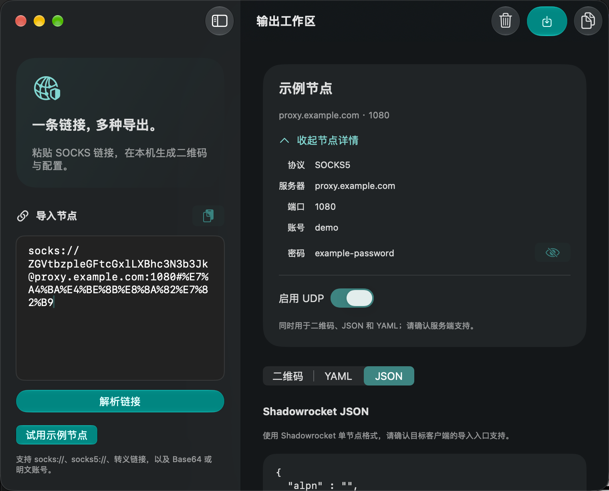
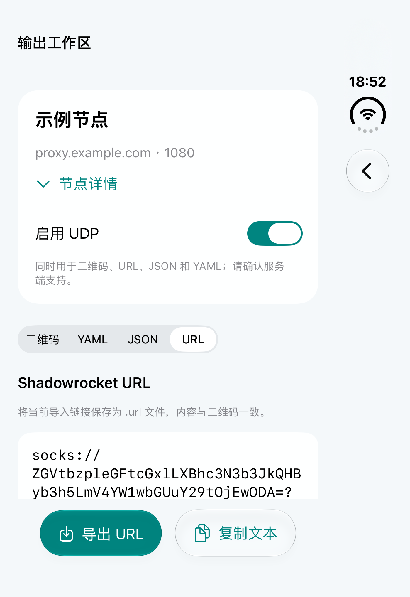
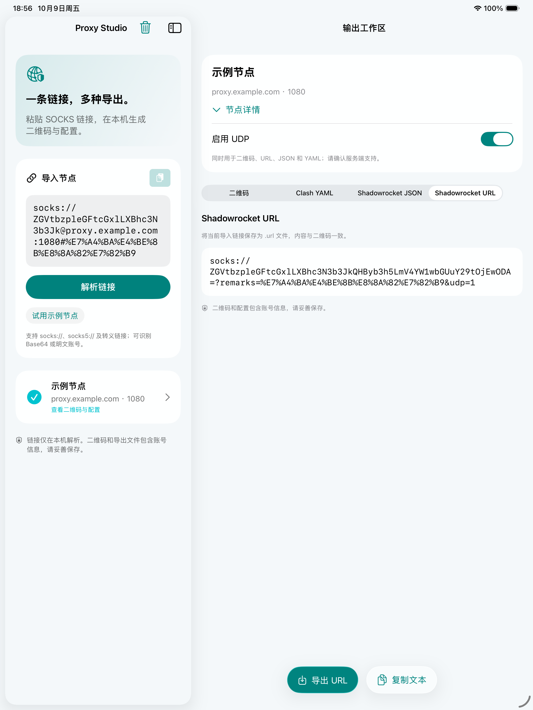
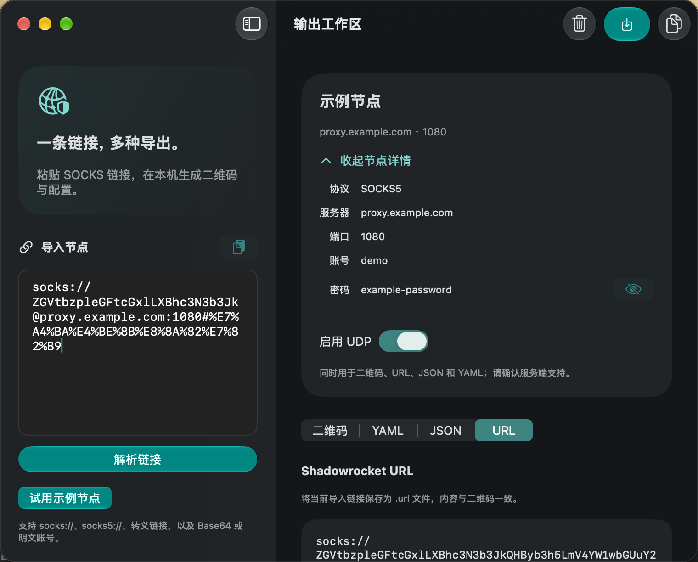

# Proxy Studio

一个使用 SwiftUI 开发的本地代理配置工具。支持 iOS 26+（iPhone、iPhone Duo、iPad）和原生 macOS 26+。

产品范围、功能规则与验收标准见 [产品需求文档](REQUIREMENTS.md)；开发协作遵循 [AGENTS.md](AGENTS.md)，实际验证状态见 [VALIDATION.md](VALIDATION.md)。

## 界面预览





二维码按内容宽度展示，最大 320 pt；短视口通过滚动查看，滚动不改变图片大小。Duo 的[滚动前截图](Preview/glass-duo-qr-before-scroll.png)与上图使用相同的二维码尺寸。







本次改版截图均来自实际运行的界面，并使用虚构示例节点。设备、外观与验收边界见 [验证记录](VALIDATION.md#2026-10-09--液态玻璃工作区改版)。

## 打开与运行

1. 使用 **Xcode 27.1 或更新版本**打开 `ProxyStudio.xcodeproj`。iPhone Duo 的完整屏幕适配依赖 iOS 27.1 SDK；工程最低运行版本仍为 iOS 26.0。
2. iOS 选择 `ProxyStudio` Scheme 和一个 iPhone / iPhone Duo / iPad 模拟器；Mac 选择 `ProxyStudioMac` Scheme 和 `My Mac`，运行。
3. 真机运行时，在 Signing & Capabilities 中选择自己的 Team，并修改 `com.example.ProxyStudio` Bundle Identifier。

工程使用 Apple 系统框架，无需 CocoaPods、外部 Swift Package 或 API 密钥。

## 原生 macOS

iOS 与 Mac 使用独立 app target 和共享源码：`ProxyStudio` / `ProxyStudioMac`，分别提供同名共享 Scheme。Mac 最低支持 **macOS 26.0**，使用原生 AppKit / SwiftUI，未使用 Mac Catalyst。

Mac 工作区左侧导入，右侧显示节点摘要及“二维码 / Clash YAML / Shadowrocket JSON / Shadowrocket URL”输出。节点名称、地址和 UDP 常驻，点击“节点详情”展开协议、账号及默认隐藏的密码。完整字段共用标签列和值列，长值按可用宽度换行。格式切换按控件所需宽度使用完整标签、YAML / JSON / URL 简写或菜单，辅助功能名称保持完整。二维码、URL、JSON 与 YAML 共用 UDP 开关并即时更新，可选择复制并按窗口宽度换行；保存内容始终使用原始文本。默认窗口内容为 1100×760 pt，最小内容为 760×560 pt；窗口和分栏调整保留会话，每个新窗口拥有独立输入、节点和输出选项。

- `⌘↩` 解析，`⇧⌘⌫` 清空，`⌘1` / `⌘2` / `⌘3` / `⌘4` 切换输出，`⌘N` 新窗口；文本标签页中 Escape 返回二维码。
- 使用原生系统保存面板和图片 / 链接分享入口。默认文件名为 `shadowrocket.png`、`clash.yaml`、`shadowrocket.json`、`shadowrocket.url`；取消不显示成功提示，也不清除会话。
- `Core` 与共享 `Services` 共用于两平台；平台入口、视图和图片分享按 target membership 隔离，无需平台条件编译。
- Mac 启用 App Sandbox，仅申请用户选择文件的读写权限；会话和凭据不写入持久化存储。

从项目根目录执行：

```sh
export DEVELOPER_DIR=/Applications/Xcode.app/Contents/Developer
xcodebuild -project ProxyStudio.xcodeproj -scheme ProxyStudioMac \
  -configuration Debug -destination 'platform=macOS' \
  -derivedDataPath .build/mac CODE_SIGNING_ALLOWED=NO build
xcodebuild -project ProxyStudio.xcodeproj -scheme ProxyStudioMac \
  -destination 'platform=macOS' -derivedDataPath .build/mac \
  CODE_SIGN_IDENTITY=- CODE_SIGN_STYLE=Manual test
./script/build_and_run.sh --verify
```

本地运行脚本使用临时签名，不改变工程的 Team 配置；默认执行停止旧 Mac 进程、构建及启动。另提供 `--debug`、`--logs`、`--telemetry`，Codex 的 Run 按钮调用同一入口。重新运行会结束旧进程的内存会话。构建产物和测试结果位于被忽略的 `.build/`。

实际构建、测试、保存文件及桌面检查证据见 [VALIDATION.md](VALIDATION.md)；macOS 26.0 最低系统运行、第三方客户端兼容性等未完成项单独记录，不由编译结果代替。

## 液态玻璃工作区

界面采用冰青通透配色：浅色冷白、深色石墨，青绿用于主要操作。解析、保存和次要操作使用系统 Liquid Glass；原生侧栏、工具栏与系统面板保持系统材质。输入、节点字段和配置正文使用稳定底色，二维码始终保留黑白像素及白色静区。

iOS 底部安全区域提供当前格式的保存及分享 / 复制操作，大字体下纵向排列；Mac 将操作集中到原生工具栏，完整导出菜单保留在“节点”菜单中。JSON / YAML / URL 在工作区随 UDP 即时更新，不再通过 iOS 预览 sheet 捕获旧快照。系统保存面板打开前仍捕获不可变文件字节，取消不清空会话、不提示成功。

## 使用

粘贴 SOCKS 链接 → 解析链接 → 输出工作区 → 保存或分享二维码，或切换到 JSON / YAML / URL 预览、复制与导出。手机解析成功后自动进入工作区；返回导入页保留 UDP、密码可见性、输出选择与节点元数据，实际修改输入才使旧结果失效。

- 支持 `socks://`、`socks5://`、`socks\://…\@…` 转义格式。
- 支持 Base64 / Base64URL 编码的 `username:password`、Shadowrocket 整体 Base64 连接信息，以及 URL 百分号编码的明文账号密码。
- 支持 IPv4、域名和方括号 IPv6，无认证节点也可导入。
- 检查端口、认证长度和非法字符；接受 `remarks` 与 `udp=0/1`，拒绝重复、冲突和未支持的查询参数，避免静默丢失连接选项。
- 二维码包含至少四模块白色静区；PNG、URL、JSON 和 YAML 都可存入“文件”。
- Clash 默认所有进入客户端的流量走节点；策略组提供 `DIRECT`，未指定 UDP 时默认关闭。
- 示例节点使用虚构域名和账号，不能用于实际连接。真实账号不会被嵌入工程或测试中。

### Shadowrocket 二维码

分享链接采用已确认的 Shadowrocket 导出格式：`socks://Base64(账号:密码@服务器:端口)?remarks=百分号编码的名称&udp=0/1`。免认证时仅编码 `服务器:端口`；IPv6 使用方括号。凭据保留原始 UTF-8 字符，完整连接信息一起进行标准 Base64 编码，名称放在 `remarks` 查询参数中。旧的 Base64 认证字段与 `#名称` 格式仍可导入。

二维码使用 H 级纠错和整数比例放大，PNG 保留白色静区；更改 UDP 后，图片和分享链接同步更新，已打开的保存面板使用字节快照。二维码载荷与用户提供样本的逐字节比较、实际 PNG 回读和客户端验证分别记录在 [VALIDATION.md](VALIDATION.md)。本机 Shadowrocket 的图片选择器禁用了 PNG 的“打开”，实际识别仍待验证。

[下载已回读的二维码格式示例（虚构节点，UDP 开启）](Preview/shadowrocket-example-qr.png)。

### Shadowrocket JSON

iOS 输出工作区切换到“Shadowrocket JSON”后即时预览，并提供“导出 JSON”和“复制文本”；Mac 使用第三种输出，也可通过工具栏和“节点”菜单导出。默认文件名为 `shadowrocket.json`。二维码、URL、JSON 与 Clash YAML 共用 UDP 开关；未携带 UDP 参数的节点默认关闭，导入带 `udp=1` 的链接时启用。两端摘要中的 UDP 开关控制同一选项，切换节点时重新使用新链接的初始状态。

JSON 按已确认的 Shadowrocket 单节点导出样本生成，顶层是一个包含 41 个字段的对象。协议为 `Socks5`，端口为字符串，UDP 为整数 `0/1`，名称、账号、密码使用 `title`、`user`、`password`。免认证时账号和密码为空字符串；IPv6 不带外层方括号。每个新解析节点拥有稳定 UUID 与创建时间，预览、切换输出和重复导出不会刷新这些元数据。

JSON 预览可选择文本并按可用宽度换行，保存时使用原始 UTF-8 字节。文件包含明文凭据，请妥善保存。本机 Shadowrocket 2.2.92 的“数据 → 导入节点”文件选择器对该 JSON 禁用了“打开”，本次未完成节点导入；具体记录见 [VALIDATION.md](VALIDATION.md)。格式仍遵循已确认的单节点样本，使用前请确认目标导入入口支持该格式。当前仅生成单节点 JSON，不提供 JSON 导入或批量节点。

### Shadowrocket URL







两端工作区新增第四种输出“Shadowrocket URL”，显示与当前二维码载荷、分享链接完全一致的 `socks://` 文本，可选择、复制并通过“导出 URL”保存。Mac 支持 `⌘4`，也可从“节点”菜单显示或导出 URL。窄窗口使用“URL”简写，辅助功能名称保持完整。

默认文件名为 `shadowrocket.url`，允许在系统保存面板中修改。文件直接保存单条链接的 UTF-8 字节，不添加 BOM、末尾换行或其他包装，与用户提供的 Shadowrocket `.url` 样本结构一致。UDP 与二维码、JSON、YAML 共用并即时更新；保存前捕获不可变快照，视觉换行不写入文件。取消保留当前节点、输出选择和详情状态。

URL 中的 Base64 可还原凭据，请妥善保存。当前只导出单节点 `.url`，不提供文件导入或批量节点。两端实际保存、扩展名与字节回读的结果，以及第三方客户端导入的验证边界，见 [验证记录](VALIDATION.md#2026-10-09--shadowrocket-url-导出)。

本应用负责生成配置，不提供 VPN 隧道、不测试节点连通性，也不在后台连接代理。输入只保存在当前内存状态中，退出应用后不保证保留；导出的文件包含认证信息。

## iPhone Duo 适配

- 使用 iOS 27.1 SDK 编译，最低部署版本为 iOS 26.0。
- `NavigationSplitView` 在窄屏折叠为单列导航，宽屏显示导入区和详情区；状态由根视图持有，窗口尺寸变化不会重建输入。
- 不通过 `UIDevice` 型号、横竖屏判断或 `UIScreen.main` 决定布局。
- 系统导航栏、表单和 sheet 处理安全区域，包括 Duo 的非对称区域；交互内容不越过安全区域。
- 支持横竖屏与可调整窗口。二维码按容器缩放；辅助功能大字体下二维码按钮改为纵向排列，正文可滚动。
- 二维码放在详情列，避免在展开时横跨导入区与详情区。

验证设备形态时请在 Xcode Device Hub 中切换外屏、展开、书本式折叠、支架姿态、横竖屏和 Split View。具体已完成的验证见 `VALIDATION.md`。

官方参考：
- [Prepare your app for iPhone Duo](https://developer.apple.com/videos/play/tech-talks/111461/)
- [Strike a pose with adaptive layouts on iPhone Duo](https://developer.apple.com/videos/play/tech-talks/111463/)
- [Mihomo SOCKS 配置](https://wiki.metacubex.one/en/config/proxies/socks/)

## 代码结构

`ProxyStudio/` 在 Xcode 中使用同步文件夹（`PBXFileSystemSynchronizedRootGroup`），目录结构直接跟随磁盘。两个 app target 共用 `Core`、`Services` 和 `Platforms/Resources`，并通过 membership exceptions 排除另一平台的源码。新增平台专属文件时，需在 File Inspector 中确认 Target Membership 仅勾选所属平台。

- `ProxyStudio/Core`：链接解析、规范化、Clash YAML 与 Shadowrocket JSON 生成。
- `ProxyStudio/Services`：平台无关的 Core Image 二维码、PNG 编码与文件文档。
- `ProxyStudio/Platforms/iOS`：iOS 应用入口、独立窗口会话、导入、即时输出工作区、原生 PNG 分享与 UIKit 剪贴板适配。
- `ProxyStudio/Platforms/macOS`：Mac 应用入口、桌面视图、`Stores/ProxySession` 和 AppKit 图片分享。
- `ProxyStudio/Platforms/Shared`：两端共用的导入说明、摘要、格式切换、输出预览与视觉语义。
- `ProxyStudio/Platforms/Resources`：两平台共享的颜色、图标资源。
- `ProxyStudioTests`：两平台共用的解析边界、IPv6、转义、YAML、JSON、URL 契约与确定性和实际 PNG 回验。
- `ProxyStudioMacTests` / `ProxyStudioMacUITests`：Mac 会话和原生桌面流程；不使用移动端旋转或文档选择器标识。
- `ProxyStudioUITests`：示例导入、详情、旋转、大字体与导出界面。

在 Xcode 中按 `⌘U` 执行测试，或：

```sh
DEVELOPER_DIR=/Applications/Xcode.app/Contents/Developer \
xcodebuild -project ProxyStudio.xcodeproj -scheme ProxyStudio \
  -destination 'platform=iOS Simulator,name=iPhone Duo' test
```

## 应用图标

已配置 AppIcon 的 Any Appearance、Dark、Tinted 三种外观，均为 1024×1024 PNG。相扣方环表达节点连接和配置转换：默认版为白色、薄荷色主体与青绿背景；深色版为青蓝、翡翠绿主体与透明背景；着色版为标准灰度图，供系统重新着色。正式资源位于 `ProxyStudio/Platforms/Resources/Assets.xcassets/AppIcon.appiconset/`，两个 app target 的 Debug、Release 均引用 AppIcon。Mac 槽位沿用默认图形，补齐 16、32、128、256、512 pt 的 1× / 2× 尺寸；iOS 三种外观资源保持原样。

使用内置 image_gen 工具创作，随后使用系统 sips 缩放，并将 Tinted 转换到 Gray Gamma 2.2。原稿、设计说明与完整提示词见 `Design/`。资源采用静态 PNG 与系统圆角裁切，未制作 Icon Composer 分层文件。


## 代码注释约定

Swift 代码采用 UIKit SDK 式的声明文档风格，并以中文描述行为：类型和成员使用 `///` 简述职责、默认值与可空语义；方法按需说明 `Parameter`、`Returns`、`Throws`；限制和重要行为使用 `Note`、`Important`。使用 `// MARK: -` 划分职责，普通 `//` 注释只解释实现原因和边界条件。测试注释描述验证契约及证据范围，避免将发出旋转请求等同于确认横屏布局。
