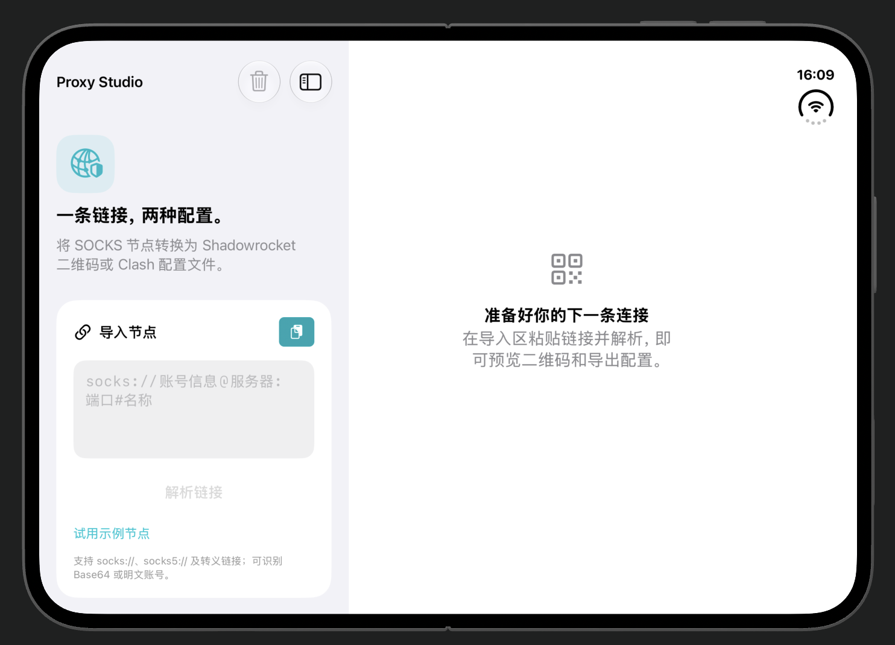

# Proxy Studio

一个使用 SwiftUI 开发的 iOS 26+ 本地代理配置工具。支持 iPhone、iPhone Duo 和 iPad。

产品范围、功能规则与验收标准见 [产品需求文档](REQUIREMENTS.md)；开发协作遵循 [AGENTS.md](AGENTS.md)，实际验证状态见 [VALIDATION.md](VALIDATION.md)。

## 界面预览



## 打开与运行

1. 使用 **Xcode 27.1 或更新版本**打开 `ProxyStudio.xcodeproj`。iPhone Duo 的完整屏幕适配依赖 iOS 27.1 SDK；工程最低运行版本仍为 iOS 26.0。
2. 选择 `ProxyStudio` Scheme 和一个 iPhone / iPhone Duo / iPad 模拟器，运行。
3. 真机运行时，在 Signing & Capabilities 中选择自己的 Team，并修改 `com.example.ProxyStudio` Bundle Identifier。

工程使用 Apple 系统框架，无需 CocoaPods、外部 Swift Package 或 API 密钥。

## 使用

粘贴 SOCKS 链接 → 解析链接 → 查看节点详情 → 保存或分享 Shadowrocket 二维码，或预览、导出 Clash YAML。

- 支持 `socks://`、`socks5://`、`socks\://…\@…` 转义格式。
- 支持 Base64 / Base64URL 编码的 `username:password`，以及 URL 百分号编码的明文账号密码。
- 支持 IPv4、域名和方括号 IPv6，无认证节点也可导入。
- 检查端口、认证长度和非法字符；拒绝未支持的查询参数，避免静默丢失连接选项。
- 二维码包含四模块白色留边；PNG 和 YAML 都可存入“文件”。
- Clash 默认所有进入客户端的流量走节点；策略组提供 `DIRECT`，UDP 默认关闭。
- 示例节点使用虚构域名和账号，不能用于实际连接。真实账号不会被嵌入工程或测试中。

本应用负责生成配置，不提供 VPN 隧道、不测试节点连通性，也不在后台连接代理。输入只保存在当前内存状态中，退出应用后不保证保留；导出的文件包含认证信息。

## iPhone Duo 适配

- 使用 iOS 27.1 SDK 编译，最低部署版本为 iOS 26.0。
- `NavigationSplitView` 在窄屏折叠为单列导航，宽屏显示导入区和详情区；状态由根视图持有，窗口尺寸变化不会重建输入。
- 不通过 `UIDevice` 型号、横竖屏判断或 `UIScreen.main` 决定布局。
- 系统导航栏、表单和 sheet 处理安全区域，包括 Duo 的非对称区域；交互内容不越过安全区域。
- 支持横竖屏与可调整窗口。二维码按容器缩放；辅助功能大字体下二维码按钮改为纵向排列，正文可滚动。
- 二维码放在详情列，避免在展开时横跨导入区与详情区。

验证设备形态时请在 Xcode Device Hub 中切换外屏、展开、书本式折叠、支架姿态、横竖屏和 Split View。具体已完成的验证见 `VALIDATION.md`。

官方参考：
- [Prepare your app for iPhone Duo](https://developer.apple.com/videos/play/tech-talks/111461/)
- [Strike a pose with adaptive layouts on iPhone Duo](https://developer.apple.com/videos/play/tech-talks/111463/)
- [Mihomo SOCKS 配置](https://wiki.metacubex.one/en/config/proxies/socks/)

## 代码结构

- `ProxyStudio/Core`：链接解析、规范化、Clash YAML 生成。
- `ProxyStudio/Services`：系统 Core Image 二维码、文件导出与分享。
- `ProxyStudio/Views`：导入、节点详情、YAML 预览。
- `ProxyStudioTests`：解析边界、IPv6、转义、YAML 和二维码回验。
- `ProxyStudioUITests`：示例导入、详情、旋转、大字体与导出界面。

在 Xcode 中按 `⌘U` 执行测试，或：

```sh
DEVELOPER_DIR=/Applications/Xcode.app/Contents/Developer \
xcodebuild -project ProxyStudio.xcodeproj -scheme ProxyStudio \
  -destination 'platform=iOS Simulator,name=iPhone Duo' test
```

## 应用图标

已配置 AppIcon 的 Any Appearance、Dark、Tinted 三种外观，均为 1024×1024 PNG。相扣方环表达节点连接和配置转换：默认版为白色、薄荷色主体与青绿背景；深色版为青蓝、翡翠绿主体与透明背景；着色版为标准灰度图，供系统重新着色。正式资源位于 `ProxyStudio/Assets.xcassets/AppIcon.appiconset/`，Debug、Release 均引用 AppIcon。

使用内置 image_gen 工具创作，随后使用系统 sips 缩放，并将 Tinted 转换到 Gray Gamma 2.2。原稿、设计说明与完整提示词见 `Design/`。资源采用静态 PNG 与系统圆角裁切，未制作 Icon Composer 分层文件。


## 代码注释约定

Swift 代码采用 UIKit SDK 式的声明文档风格，并以中文描述行为：类型和成员使用 `///` 简述职责、默认值与可空语义；方法按需说明 `Parameter`、`Returns`、`Throws`；限制和重要行为使用 `Note`、`Important`。使用 `// MARK: -` 划分职责，普通 `//` 注释只解释实现原因和边界条件。测试注释描述验证契约及证据范围，避免将发出旋转请求等同于确认横屏布局。
